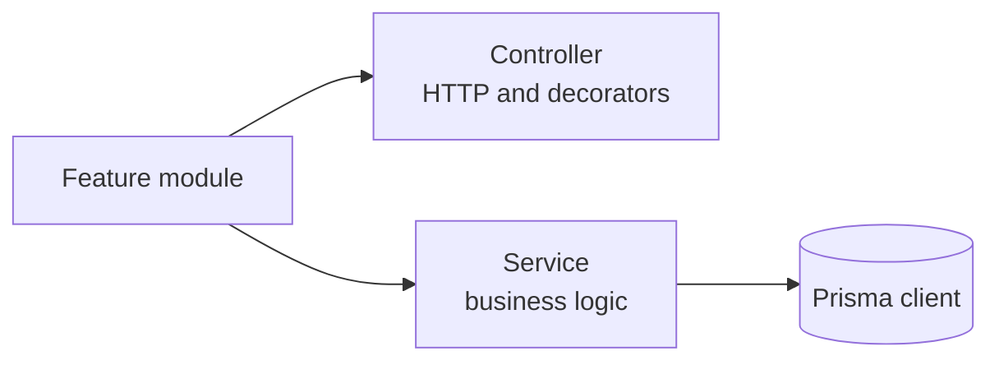
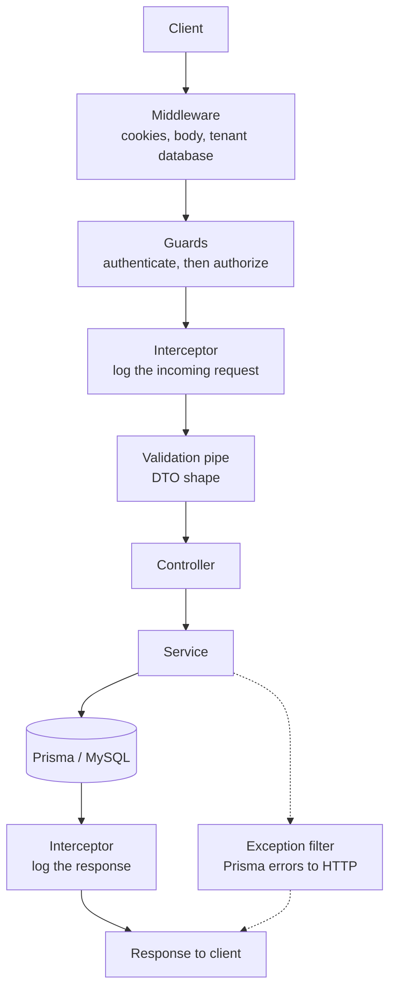
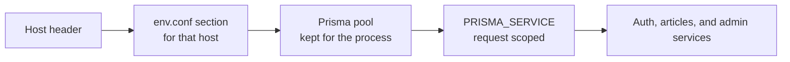
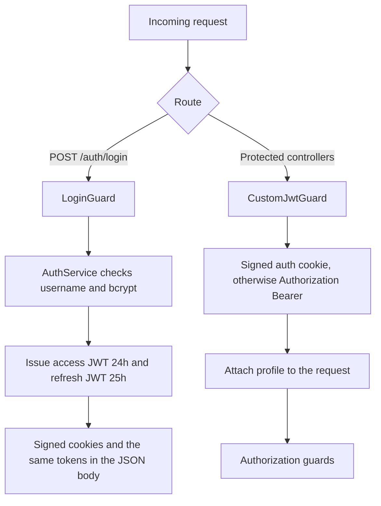
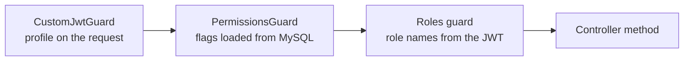

# Architecture

This is a NestJS API on Prisma and MySQL. One process serves many tenants, each with its own database. Callers log in with JWT. Roles and permissions decide what they can do. Articles is the sample feature those rules protect.

## 1. Nest shape

Nest groups each feature into a module. The module declares a controller and the service it injects. `ArticlesModule` is the pattern: `ArticlesController` accepts HTTP, `ArticlesService` does the work.



## 2. Request flow

A request starts at the client. It does not reach a service directly. Nest runs the shared steps first, in this order.



Middleware reads cookies and the body, then selects the tenant database for this host. Guards authenticate the caller, then check what they may do. The validation pipe checks the DTO: transform types, strip unknown fields, reject extra fields. The controller reads that DTO and calls the service. The service queries MySQL through Prisma. On the way back, the interceptor logs the response. If Prisma throws, the exception filter turns that error into an HTTP response.

## 3. Multi-tenant

One process serves many hosts. The database has to be chosen in middleware, before guards and services, because those classes inject the Prisma client for the current request.



`env.conf` is an INI file. The section name is the host, for example `localhost:3000`. The section holds the MySQL user, password, host, and database name. The first request for a host opens a pool. Later requests for that host reuse it. An unknown host gets `404 Tenant not found`.

`.env` `DATABASE_URL` is for the Prisma CLI and the seed script. Request handling uses the `env.conf` URL.

## 4. Authentication guards

Authentication answers "who is this?". Two guards do that job, on different routes.



`LoginGuard` runs only on login. It resolves `AuthService` for this request, loads the user, and compares the password with bcrypt. On success the controller calls `login()`.

`login()` puts the user's `roleName` list on a profile, signs an access token for 24 hours (`86400s` in `JwtModule`), and signs a refresh token for 25 hours. The refresh token is also stored in `UserRefreshToken`. Both tokens are returned in the body and set as signed cookies. Cookie names come from the tenant section: `AUTH_COOKIE_NAME` and `REFRESH_COOKIE_NAME`.

`POST /auth/refresh-token` accepts the refresh token in the body, marks that database row revoked, and issues a new pair.

`CustomJwtGuard` is what protected controllers use. It reads the signed auth cookie, then a Bearer token. The profile from the token is what the role guard reads later.

`POST /auth/signup` creates a user with a bcrypt password and no role. Login works afterward. Protected controllers still reject that user until a role is assigned.

## 5. Authorization guards

Authorization answers "what may this person do?". It runs only after authentication has put a profile on the request. On articles and admin the order is fixed: permissions, then roles.



Roles are the names signed into the token, compared as strings:

```typescript
@Roles({ OR: ['ADMIN', 'SUPER ADMIN'] })
```

The seed creates those two names. `SUPER ADMIN` receives every Article flag. `ADMIN` receives `Article.view`.

Permissions are rows in `ResourcePermission`: a resource name plus `create`, `view`, `update`, and `delete`. The guard loads the rows for the caller's role names on each request, so a permission change applies without a new login. Role changes apply on the next login, because the names live in the token.

Article routes ask for one flag:

```typescript
@Permissions({ AND: ['Article.create'] })
```

`AND` and `OR` can be nested. Admin routes set the role and do not set `@Permissions`, so the permission guard allows them through and the role guard is the check.

## 6. Request response interceptor

`RequestResponseInterceptor` is bound on every route. On the way in it logs the host, URL, and body. On the way out it logs the response body. This runs only when `LOG_REQUESTS` is on. Set to `0`, the interceptor lets the request through without logging.

## 7. Prisma

The service is the only layer that queries MySQL. It receives the tenant client as `PRISMA_SERVICE`, not a single global client. The schema has an identity side and a content side:

- `User`, `UserRole`, `Role`, `ResourcePermission`, `UserRefreshToken`
- `Article`, with no user foreign key

`User` reaches a role only through `UserRole`. Permissions belong to a role. Foreign keys use `ON DELETE RESTRICT`.

`prisma migrate dev` writes a SQL file under `prisma/migrations` when the schema changes. `prisma migrate deploy` applies the files that have not run yet. Prisma records each applied file in the `_prisma_migrations` table in that MySQL database, and the next deploy skips those rows. The CLI reads `.env` `DATABASE_URL`, so point that URL at the tenant database you are updating.

`PrismaClientExceptionFilter` runs only when Prisma throws. A unique value or a foreign key that blocks the change is `409`. A missing row is `404`.

## 8. Swagger

`main.ts` builds the document from the same controllers and DTO classes the pipe validates. It is mounted at `/swagger` when `PRODUCTION` is `0`, with Bearer auth so a caller can paste the access token. Controllers add `@ApiTags` and `@ApiBearerAuth`. Response decorators such as `@ApiOkResponse` name the shape of the JSON. In production that UI is left off and CORS stays off with it.
