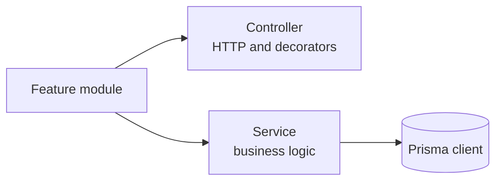
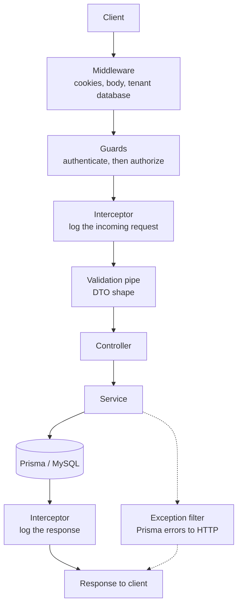
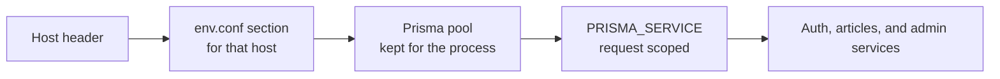
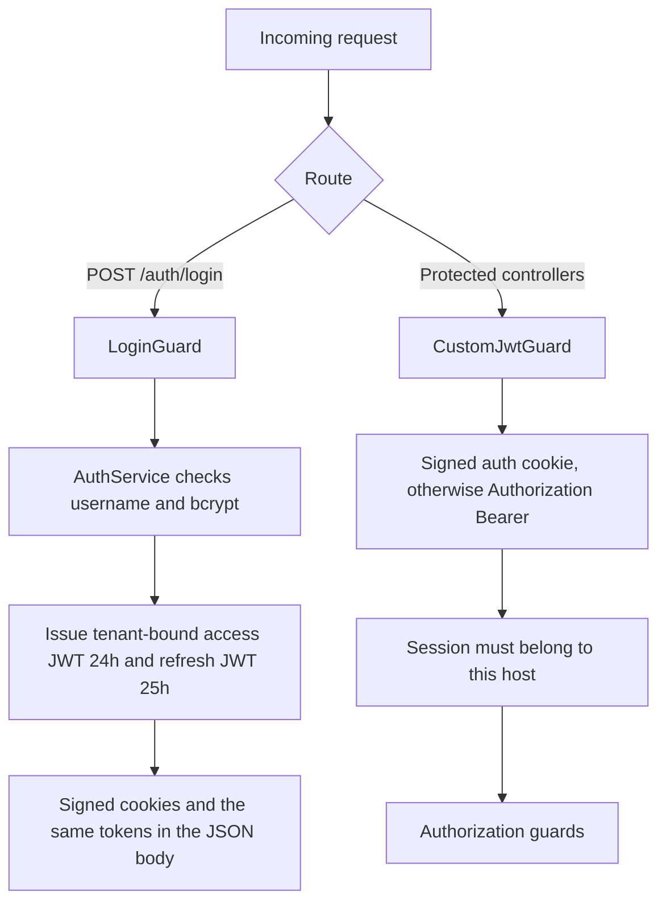
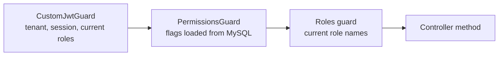

# Architecture

This is a NestJS API on Prisma and MySQL. One process serves many tenants, each with its own database. Callers log in with JWT. Roles and permissions decide what they can do. Articles is the sample feature those rules protect.

## 1. Nest shape

Nest groups each feature into a module. The module declares a controller and the service it injects. `ArticlesModule` is the pattern: `ArticlesController` accepts HTTP, `ArticlesService` does the work.



## 2. Request flow

A request starts at the client. It does not reach a service directly. Nest runs the shared steps first, in this order.



Middleware reads cookies and the body, then selects the tenant database for this host. Guards authenticate the caller, then check what they may do. The validation pipe checks the DTO: transform types, strip unknown fields, reject extra fields. The controller reads that DTO and calls the service. The service queries MySQL through Prisma. On the way back, the interceptor logs the response. If Prisma throws, the exception filter turns that error into an HTTP response.

## 3. Multi-tenant

One process serves many hosts. The database has to be chosen in middleware, before guards and services, because those classes inject the Prisma client for the current request.



`env.conf` is an INI file. The section name is the host, for example `localhost:3000`. The section holds the MySQL user, password, host, and database name. The first request for a host opens a pool. Later requests for that host reuse it. An unknown host gets `404 Tenant not found`.

`.env` `DATABASE_URL` is for the Prisma CLI and the seed script. `prisma.config.ts` loads that file. Request handling uses the `env.conf` fields. Each host gets a Prisma 7.10.1 client that connects through the MariaDB driver, with a pool of 20 connections.

## 4. Authentication guards

Authentication answers "who is this?". Two guards do that job, on different routes.



`LoginGuard` runs only on login. It resolves `AuthService` for this request, loads the user, and compares the password with bcrypt. On success the controller calls `login()`. A password longer than 72 bytes is rejected before that comparison, because bcrypt would ignore the extra bytes. Signup and user create or update require at least 8 characters and at most 72 bytes.

`POST /auth/login`, `POST /auth/signup`, and `POST /auth/refresh-token` allow 10 attempts per minute for each connecting address. The three routes have separate counts. The limit lives in this process, so each process keeps its own window, and it uses the socket address rather than a forwarded header.

`login()` puts the user's current `roleName` list on a profile and opens one session row in `UserRefreshToken`. The access token is signed for 24 hours (`86400s` in `JwtModule`) and carries `sub`, `sid`, `tenant`, and `tokenUse: access`. The refresh token is signed for 25 hours with `tokenUse: refresh`. The row stores the SHA-256 of the refresh token. `sid` is a random 40-character id. Both tokens are returned in the body and set as signed cookies. Cookie names come from the tenant section: `AUTH_COOKIE_NAME` and `REFRESH_COOKIE_NAME`.

`tenant` is the request host, normalized the same way the tenant middleware chooses a database. A token from one host is rejected on another host. Seeded user ids are the same in every tenant database (`ADMIN`, `SUPERADMIN`), so the host claim and the session row are what keep a login inside the tenant that created it.

`POST /auth/refresh-token` checks the refresh token's signature, `tenant`, and hash. A matching active row is revoked and a new session is issued. Presenting a refresh token whose row is already revoked revokes every active session for that user.

`CustomJwtGuard` is what protected controllers use. It reads the signed auth cookie, then a Bearer token. It rejects the token when the signature is invalid, `tokenUse` is not `access`, `tenant` is not this host, or the `sid` row is missing, revoked, or expired. It then loads the user's current role names onto the profile. That profile is what the later guards read.

`POST /auth/logout` revokes the session in the presented access or refresh token and clears both cookies. `POST /auth/logout-all` revokes every active session for the caller. `POST /admin/users/:id/sessions/revoke` does that for a chosen user. Admin routes still require `ADMIN` or `SUPER ADMIN`. A database reset deletes the session rows, so tokens issued before the reset stop working and the user has to log in again.

`POST /auth/signup` creates a user with a bcrypt password and no role. Login works afterward. Protected controllers still reject that user until a role is assigned.

## 5. Authorization guards

Authorization answers "what may this person do?". It runs only after authentication has put a profile on the request. On articles and admin the order is fixed: permissions, then roles.



Roles are the user's current role names, compared as strings:

```typescript
@Roles({ OR: ['ADMIN', 'SUPER ADMIN'] })
```

The seed creates those two names. `SUPER ADMIN` receives every Article flag. `ADMIN` receives `Article.view`.

Permissions are rows in `ResourcePermission`: a resource name plus `create`, `view`, `update`, and `delete`. The permission guard loads the rows for the caller's current role names on each request. `CustomJwtGuard` loads those names from `UserRole` on each request, so a role or permission change applies on the next request. The access token still carries the roles from login; authorization does not use that copy.

Article routes ask for one flag:

```typescript
@Permissions({ AND: ['Article.create'] })
```

`AND` and `OR` can be nested. When the caller has more than one role, flags for the same resource are combined: a flag is granted when any matching row sets it. The guard reads `create`, `view`, `update`, and `delete`. Admin routes set the role and do not set `@Permissions`, so the permission guard allows them through and the role guard is the check.

## 6. Request response interceptor

`RequestResponseInterceptor` is bound on every route. When `LOG_REQUESTS` is `0`, including the string `"0"`, it does not log. Otherwise it logs the host, URL, request body, and response body after replacing `password`, `refreshToken`, `authToken`, and `authorization` with `[redacted]`. Dates are left unchanged.

## 7. Prisma

The service is the only layer that queries MySQL. It receives the tenant client as `PRISMA_SERVICE`, not a single global client. The schema has an identity side and a content side:

- `User`, `UserRole`, `Role`, `ResourcePermission`, `UserRefreshToken`
- `Article`, with no user foreign key

`User` reaches a role only through `UserRole`. Permissions belong to a role. Foreign keys use `ON DELETE RESTRICT`.

Primary keys are `CHAR(40)` strings. Prisma Client fills a new row with a UUID version 7 when the create call leaves the id out. That value sorts by time and is unique across processes, so the API does not generate ids itself. `autoincrement()` is not used: these ids are returned to callers, and the seed uses the same `ADMIN` and `SUPERADMIN` ids in every tenant database. `UserRefreshToken.userRefreshTokenId` is the exception. Login sets it to 40 random hex characters, and the column has no default, because that id is the session key inside the JWT. Existing rows keep the ids they already have. A UUID version 7 is 36 characters, so it fits the same column.

`prisma migrate dev` writes a SQL file under `prisma/migrations` when the schema changes. `prisma migrate deploy` applies the files that have not run yet. Prisma records each applied file in the `_prisma_migrations` table in that MySQL database, and the next deploy skips those rows. The CLI reads `.env` `DATABASE_URL`, so point that URL at the tenant database you are updating.

`PrismaClientExceptionFilter` runs only when Prisma throws. A unique value or a foreign key that blocks the change is `409`. A missing row is `404`.

## 8. Swagger

`main.ts` builds the document from the same controllers and DTO classes the pipe validates. It is mounted at `/swagger` when `PRODUCTION` is `0`, with Bearer auth so a caller can paste the access token. Controllers add `@ApiTags` and `@ApiBearerAuth`. Response decorators such as `@ApiOkResponse` name the shape of the JSON. In production that UI is left off and CORS stays off with it.

## 9. Tests

`yarn test` runs the unit specs next to the source. `yarn test:e2e` boots this application and sends HTTP through the same middleware, guards, pipe, and Prisma filter. Neither command opens MySQL. The HTTP suite uses an in-memory client for `localhost:3000`. The cases and commands are in [TESTING.md](../guidelines/TESTING.md).
